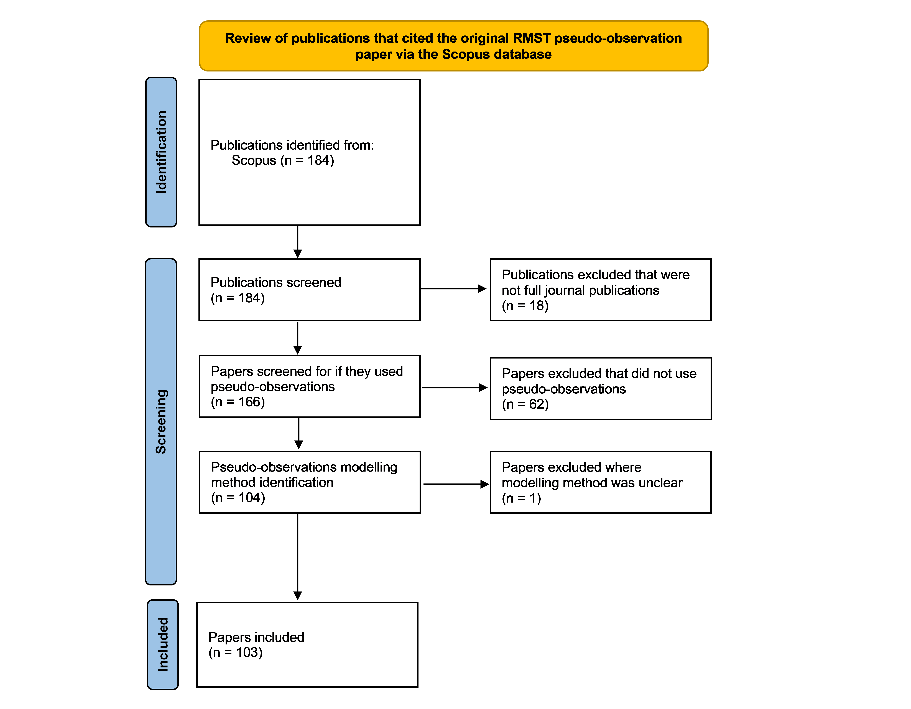
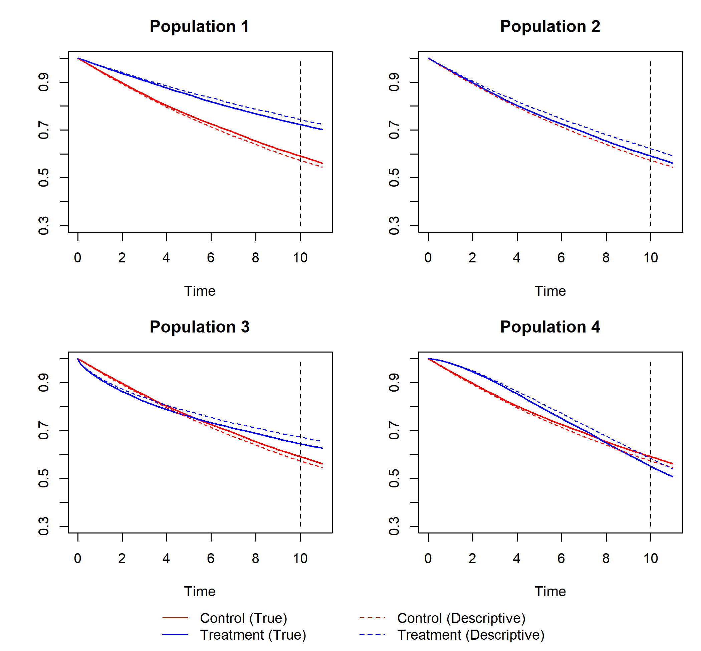
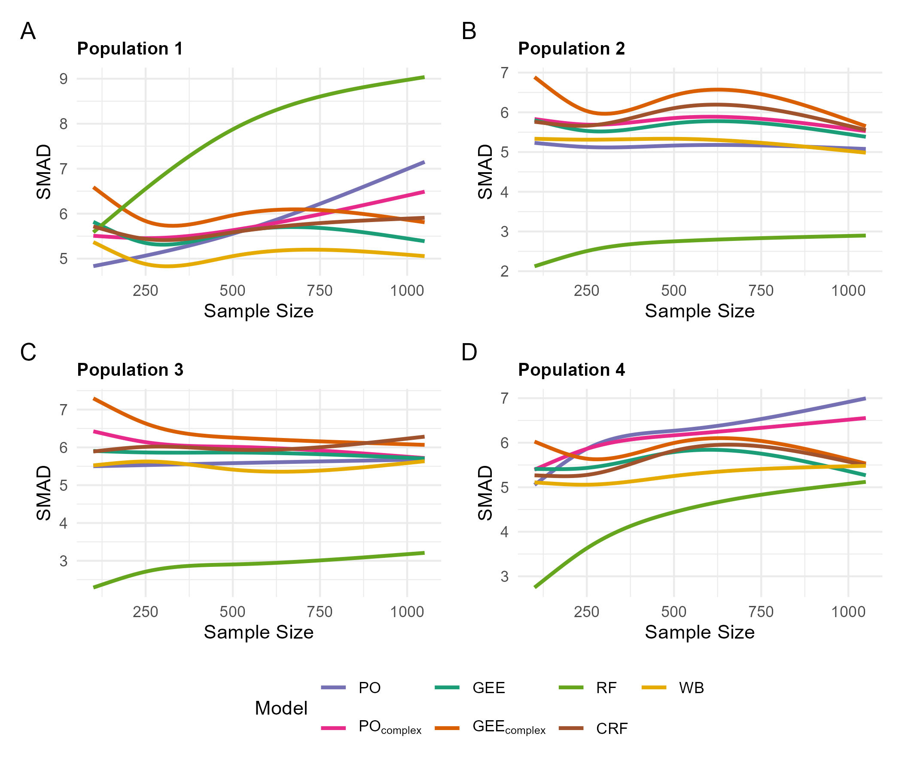
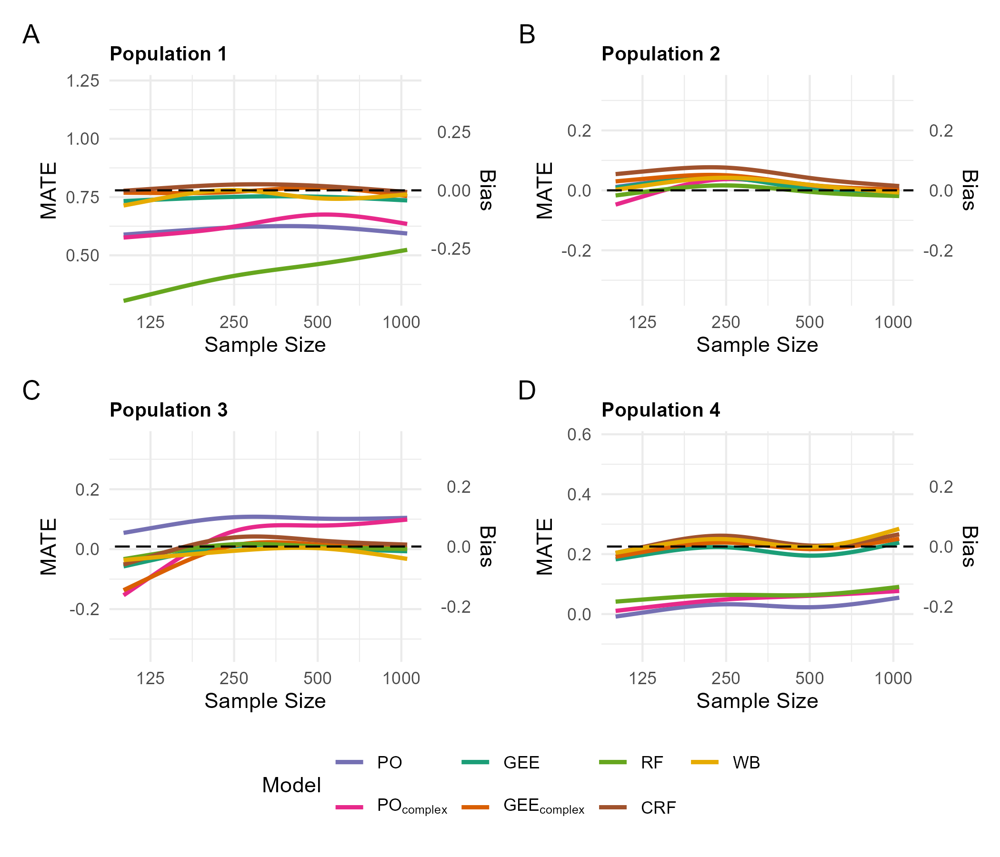
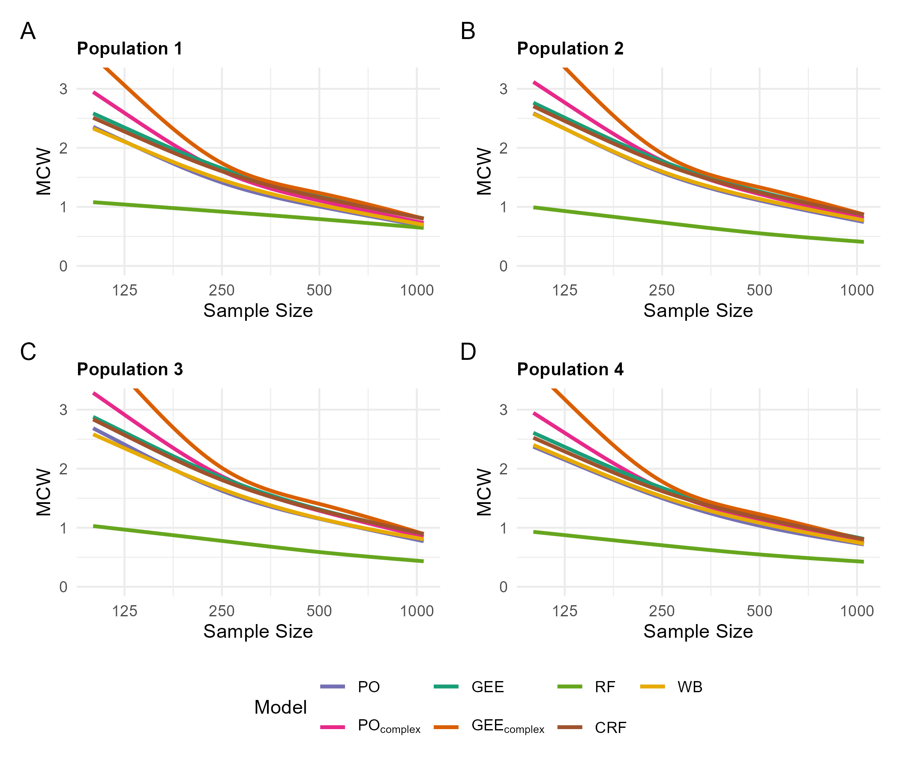
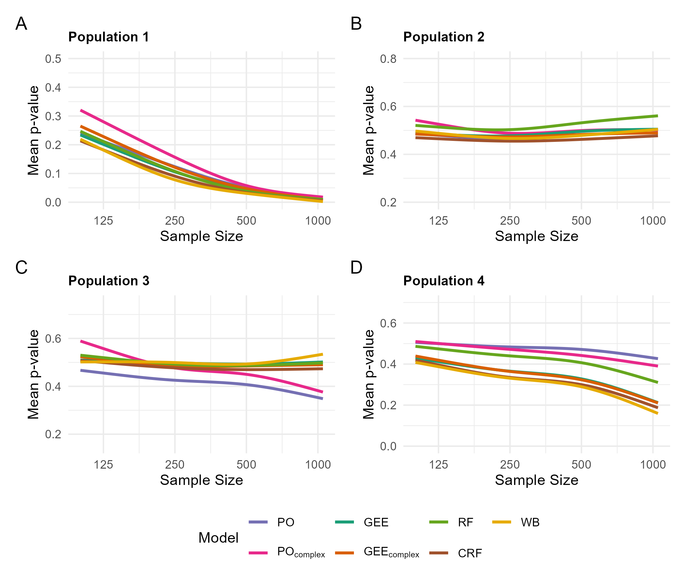

\newpage
## Introduction

In 2003 Andersen and Klein et al. first introduced regression analysis on the so-called \textit{pseudo-observations} in survival analysis [@andersen2003generalised].  Expanded upon in various papers, these pseudo-observations are useful because right-censored data can be transformed into complete data, with a value for each observation [@andersen2004regression] [@klein2005regression] [@klein2006modelling] [@andersen2007regression] [@parner2010regression]. Classic regression methods can be used on these values without worrying about censoring, making inference and predictions from statistical models not suited to survival analysis possible.

Pseudo-observations are essentially leave-one-out estimators and can be used for estimating the survival curve $S(\tau)$ or restricted mean survival time $RMST(\tau)$, where $\tau$ is a specific timepoint. $S(\tau)$ is the value of the survival curve at this timepoint, while $RMST(\tau)$ corresponds to the area under the survival curve $S$ up until $\tau$. The Average Treatment Effect (ATE) is used to estimate the causal effect of a treatment.

Classic regression methods that use pseudo-observations based on either $S(\tau)$ or $RMST(\tau)$ as the outcome have properties well suited for inference [@andersen2003generalised] [@andersen2004regression].  This makes it possible to easily calculate the covariate-adjusted ATE from a model with pseudo-observations as the outcome in a survival analysis setting.

### Literature Review

Modelling pseudo-observations in survival analysis is typically done using a Generalized Linear Model (GLM) framework, most of the time Generalized Estimating Equations (GEE) specifically. Andersen, Hansen and Klein's work [@andersen2004regression], the first publication about the use of pseudo-observations for the RMST, was cited by 184 other scientific publications as of March 2026, based on the Scopus database. 

```{r}
#| include: false

 #Before 2020 the 'other' methods can still be described as classical statistical analyis methods, while from 2020 onward they are mostly machine learning and Bayesian approaches
```


Of these 184 scientific publications, 18 were not full journal publications (papers), 62 did not use pseudo-observations, and 1 was unclear on the type of modelling method used ([@fig-flowchartlitrev]). To examine the methods for modelling pseudo-observations used in the literature so far, we reviewed the modelling method for each paper. 92 of these 103 papers (89%) used a GLM framework for modelling, while 17 used some 'other' method (17%), with 8 (8%) utilizing both and 2 being purely theoretical. The number of pseudo-observation papers using 'other' methods was 0 in 2007–13 (out of 12 papers; 0%), 2 in 2014–17 (out of 22; 9%), 4 in 2018–21 (out of 26; 15%) and 11 in 2022–26 (out of 43; 26%).

{#fig-flowchartlitrev}


From our view, modelling pseudo-observations in a non-conventional (non-GLM) framework has become increasingly popular over the last years, though properties of such frameworks may be unclear. It is therefore important to compare non-conventional methods with the theoretically justified GEE in simulations, which only 3 of the 17 papers with 'other' methods did [@orsini2025bayesian] [@wang2024tau1] [@wang2024tau2].

```{r}
#| include: false

# To further search for modelling comparisons between GEE and other methods in simulations, we used an elaborate search term on Scopus to search for simulation studies about pseudo-observations in survival analysis from popular biostatistics journals (the exact search term can be found in the supplement). As of January 2026, 209 publications are found with this search term on Scopus. Based on title, abstract and, if unclear, a full text review, we found that none of these 209 publications examined performance differences of GEE and other modelling approaches for pseudo-observations in a simulation study for survival analysis. The 3 papers that conducted a simulation study comparing GEE with their method were not found with this search term.

# In summary, while there is an influx of new methods for modelling pseudo-observations, we hardly found any publications actually comparing the performance of these methods with GEE models.
```

This paper will present a simulation study concentrating on the restricted mean survival time (RMST), where pseudo-observations are calculated and used as the outcome variable in various modelling approaches. Performance comparisons are done by examining bias and precision of the estimated average treatment effect (ATE) on RMST, in a simulation study described with the ADEMP structure [@morris2019using].

Unlike conventional simulation studies that rely on many repetitions at a limited set of sample sizes, this study employs a different strategy: the computational complexity is shifted toward covering a wide range of sample sizes $n$ with few repetitions. This gives us a more general picture of the impact $n$ has on the performance measures and allows us to pinpoint critical sample sizes, using smoothers for visualization instead of point estimates.


## Background and Notation

### RMST - Restricted Mean Survival Time

Following the explanations given in [@andersen2004regression], [@guo2019analyzing] and [@hazra2017biostatistics], assume the target population is homogenous, which means that regardless of when the subjects enter the study, they do not represent separate cohorts in respect to their baseline risk or nature of treatment. Let $T$ be a non-negative random variable that corresponds to the failure time of an individual from this population. The survival function is defined as

\begin{equation}
    S(t)=P(T>t)
\end{equation}

If the mean survival time $\mu$ exists, it is given by

\begin{equation}
    \mu=\int_0^\infty S(t) \, dt
\end{equation}

which is the area under the survival curve. With right-censoring, the calculation of the tail of the survival function is often problematic. Instead of $\mu$, it is possible to calculate the restricted mean survival time

\begin{equation}
    \mu(\tau)=RMST(\tau)=\int_0^\tau S(t) \, dt
\end{equation}

which is just the area under the survival curve up to the point $\tau < \infty$. The interpretation of $\mu(\tau)$ can be more relevant than the interpretation of $\mu$ as well. For example, $\mu(2)$ could be the expected time until recurrence of a disease up to 2 years after treatment.

Since the true survival curve is not known and right-censoring occurs, estimation of the survival function $S(t)$ with right-censoring can be done via the Kaplan-Meier estimator [@kaplan1958nonparametric]. 

### ATE - Average Treatment Effect {#sec-ATEchapter} 

The \textit{Average Treatment Effect} (ATE) represents the expected difference in outcomes between treated and untreated subjects in a population. Let $A$ be a binary variable with $A \in \{0,1\}$, indicating whether a subject is treated or untreated, and $Y$ be the outcome. Mathematically the ATE is then given by the difference $\mathbb{E}[\mathbb{E}[Y|A=1,X] - \mathbb{E}[Y|A=0,X]]$, where $Y(1)$ denotes the potential outcome if treatment is applied ($\Leftrightarrow A=1$), $Y(0)$ denotes the potential outcome if the treatment is not applied ($\Leftrightarrow A=0$), and $X$ is a matrix containing the confounding variables. Furthermore, it is assumed that the distribution of $X$ may differ between treated and untreated subjects. This is usually the case in observational studies, and not the case in randomized studies. If of interest, a detailed introduction into the Neyman–Rubin potential outcome framework is found in [@holland1986statistics].


Calculating the ATE is often more complex than just directly computing the average difference between a treated and untreated group. If there are interactions of the binary variable $A$ with $X$ or if $X$ is relevant for $Y$ prognostically, a model-estimated ATE is useful to adjust for confounding and interactions. By using a suitable structure and method for the model, it is then possible to identify the ATE. Identifying the ATE directly from model outputs is often more complicated than just taking the value of $\hat{\beta}_{A}$, or even impossible with black-box methods like the random forest. It is however possible to calculate the ATE from the model's prediction, for example for the RMST, similar to what was done in [@wager2018estimation]:


\begin{equation}
    \label{eqn:ATE_estimate_from_predictions}
    \hat{ATE} = \frac{1}{n} \sum_{i=1}^n [\hat{y}_i(A=1, X=x_i) - \hat{y}_i(A=0, X=x_i)]
\end{equation}

In this example, $\hat{y}_i(A=1, X=x_i)$ is the predicted RMST for the ith subject, with explanatory variable values $x_i$ and assuming that treatment was applied, i.e. $A=1$. $\hat{y}_i(A=0, X=x_i)$ is then the predicted RMST for the ith subject with exactly the same values for all variables except for $A = 0$. Both possible predictions for $y_i$ are called potential outcomes for subject $i$.

While there is theory supporting the normal distribution of $\hat{ATE}$ from generalized linear models, there is generally no theory supporting this assumption for flexible machine learning models [@Hoffman2022gcomputation].  In such situations, the ATE can be estimated as shown in equation \ref{eqn:ATE_estimate_from_predictions}, using any models fitted with pseudo-observations as the outcome. Confidence intervals can be obtained through bootstrap replications, building a model on each bootstrap sample. 

To calculate the \textit{ATE}, one would have to know exactly how the true RMSTs differ for each subject of a (finite) population between the cases $A=1$ and $A=0$, and use equation \ref{eqn:ATE_estimate_from_predictions}, replacing the estimates by the true quantities. This is naturally not possible in real observational studies, but easily possible in a simulation. The resulting survival curves (using the same population with $A=1, A=0$) will be called \textit{True} survival curves. In realistic observational studies, treatment allocation $A$ may be dependent on $X$. The \textit{True} survival curves can then be compared to simple Kaplan-Meier estimated survival curves, which will be called \textit{Descriptive} survival curves, where the treatment allocation $A$ may be based on $X$ and the distribution of $X$ may differ between the treated and untreated population. The \textit{raw ATE} is then calculated as the difference between the RMSTs of the \textit{Descriptive} survival curves.

### Pseudo-Observations

Following Andersen, Hansen and Klein [@andersen2004regression], pseudo-observations are defined as follows: let $X_i,i=1,...,n$ be independent and identically distributed random variables, $f$ be an arbitrary function, $\theta$ be a parameter of the form

\begin{equation}
    \theta=\mathbb{E}f(X_i)
\end{equation}

and $\hat{\theta}$ an approximately (or fully) unbiased estimator for a fixed time point, like the Kaplan-Meier estimator or the RMST. This chapter will denote $\hat{\theta}$ as $\hat{RMST}(\tau)$ from here on out. The pseudo-observation for $y_i$ is now defined as

\begin{equation}
    \theta_{(i)}=n\cdot\hat{\theta}-(n-1)\cdot\hat{\theta}_{-i}
\end{equation}

which is equivalent to

\begin{equation}
    \label{eqn:second pseudo-observation formula}
    \theta_{(i)}=\hat{\theta}+(n-1)\cdot(\hat{\theta}-\hat{\theta}_{-i})
\end{equation}

where $\hat{\theta}_{-i}$ is $\hat{RMST}(\tau)$ with observation $i$ left out.

Pseudo-observations are invariant for the mean. One can simply define $\hat{\theta} = \frac{1}{n}\sum_{i=1}^n y_i$ as the mean and obtain $y_i$, which is just some data value, directly:

\begin{equation}
    \begin{split}
        \theta_{(i)} &= \hat{\theta}+(n-1)\cdot(\hat{\theta}-\hat{\theta}_{-i}) \\
        &= \sum_j \frac{y_j}{n} + (n-1) (\sum_j \frac{y_j}{n}-\sum_{j \neq i} \frac{y_j}{(n-1)}) \\
        &= \sum_j y_j - \sum_{j \neq i} y_j \\
        &= y_i
    \end{split}
\end{equation}

[@TherneauVignette2024]


This is a key result because the Kaplan-Meier estimator, and thus by extension the estimator of the RMST, is asymptotically unbiased and consistent. This in turn means that directly modelling pseudo-observations as the outcome gives asymptotically correct coefficient values for the mean of either $\hat{S}(\tau)$ or $\hat{RMST}(\tau)$, and these coefficient values can thus be directly interpreted. For example, if $\hat{\beta}_1=2$, where $\hat{\beta}_1$ is the estimate of the coefficient for $X_1$ from a model with pseudo-observations for $RMST(\tau)$ as the outcome, this can be directly interpreted as: for every 1-unit increase in $X_1$, $RMST(\tau)$ is estimated to increase by 2 units if other covariates are held constant.

## Simulation Study

This simulation study compared the ability of multiple modelling methods, including the standard, GEE, in a causal inference setting. Table \ref{tab:scenarios} shows the overall structure of this study. By combining four different data generating mechanisms (populations) and three different levels of censoring, 12 scenarios were examined:

\begin{table}[H]
    \centering
    \begin{tabular}{cccccc}
        \toprule
        Scenario & Population & Censoring & $ATE$ & Raw $ATE$ & Hazards  \\
        \midrule
        1 & 1 & 20\% & 0.777 & 1.1 & proportional\\
        2 & 1 & 40\% & 0.777 & 1.1 & proportional \\
        3 & 1 & 60\% & 0.777 & 1.1 & proportional \\
        4 & 2 & 20\% & 0 & 0.384 & proportional \\
        5 & 2 & 40\% & 0 & 0.384 & proportional \\
        6 & 2 & 60\% & 0 & 0.384 & proportional \\
        7 & 3 & 20\% & 0 & 0.399 & non-proportional \\
        8 & 3 & 40\% & 0 & 0.399 & non-proportional \\
        9 & 3 & 60\% & 0 & 0.399 & non-proportional \\
        10 & 4 & 20\% & 0.224 & 0.582 & non-proportional \\
        11 & 4 & 40\% & 0.224 & 0.582 & non-proportional \\
        12 & 4 & 60\% & 0.224 & 0.582 & non-proportional \\
        \bottomrule
    \end{tabular}
    \caption{Simulation Scenarios}
    \label{tab:scenarios}
\end{table}

'$ATE$' refers to the RMST-difference between the \textit{True} survival curves, while 'Raw $ATE$' refers to the RMST-difference between the \textit{Descriptive} survival curves (see the ATE section for details). The comparison between the different modelling approaches was done via visual inspection over a grid of sample sizes $n=100,...,1050$, where estimands for each sample size were smoothed.

### ADEMP

A detailed explanation of the simulation study framework is provided here, using the popular ADEMP (\textbf{A}im, \textbf{D}ata-Generating Mechanism, \textbf{E}stimands and Targets of Analysis, \textbf{M}ethods, \textbf{P}erformance Measures) structure [@morris2019using]. 

The **Aim** of this simulation study was to compare the performance of modelling approaches in estimating the ATE with pseudo-observations of the RMST at $\tau = 10$ as outcome variable.

The **Data-Generating Process** for this simulation study consisted of simulating independently right-censored survival data following a Weibull distribution, influenced by baseline covariates $X_1, X_2, X_3, X_4$ and a confounded binary treatment variable $A$. The survival times of the resulting populations can be seen in @fig-populationKM, where the 'True' treatment effect and the 'Descriptive' (observed) treatment effect is shown. Further details on what 'True' and 'Descriptive' means are found in the ATE section, while the details of the data generation are included in the Supplement.

{#fig-populationKM}

The **Estimands** were the ATE and its cumulative bootstrap distribution $P_B$. In each simulation repetition, they were estimated by each method. Further targets were the 95\% confidence interval $CI(ATE)=[ATE_L, ATE_U]$ and the proportion of bootstrapped ATE estimates smaller than zero $P_B(0)$.

$ATE_L$ and $ATE_U$ were estimated by taking the 2.5th and 97.5th percentile of bootstrapped ATE estimates, respectively. $P_B(0)$ was estimated using $\hat{P}_B(0) = \frac{1}{R}\sum_{r=1}^R \mathbb{1} (\hat{ATE}^{*(r)}<0)$, where $\mathbb{1}$ is the indicator function and $\hat{ATE}^{*(r)}$ is the model-based ATE estimate in bootstrap replication number $r=1,...,R$. Thus $\hat{P}_B(0)$ describes the proportion of bootstrapped ATE estimates smaller than zero. This number can be interpreted as a one-sided bootstrap p-value. Additionally, $\hat{P}_B(0)$ contains information on whether the confidence interval (for any significance level) includes zero. For a 5\% significance level, if $0.025 \leq \hat{P}_B(0)  \leq 0.975$, the confidence interval includes zero, i.e. $0 \in [ATE_L,ATE_U]$.


Seven **Methods** were used to estimate the ATE and its bootstrap distribution. Generalized Estimating Equations and the Proportional Odds model are semi-parametric models, included in a simple form with linear effects ($GEE$ and $PO$) and as complex models, with spline-transformed covariates and an interaction with the treatment allocation variable $A$ ($GEE_{complex}$ and $PO_{complex}$). Random Forest and Causal Random Forest ($RF$ and $CRF$) are non-parametric methods. The true data-generating Weibull model ($WB$) serves as a benchmark and oracle.

The exact structure of the models will be shown in a \textit{conceptual} way, omitting coefficients and link functions. This information will instead be explained in text. Now, $GEE$ and $PO$ assumed a simple structure:

\begin{equation}
    \theta = X_1 + X_2 + X_3 + X_4 + A
\end{equation}

where $\theta$ is a vector of the pseudo-observations for $RMST(\tau=10)$. $GEE$ uses an identity link, an independent correlation structure and the standard sandwich estimator. $PO$ is a cumulative logit link model, and the mean instead of the mode is predicted. The idea behind $PO$ was to use a method that is flexible in that it does not directly assume a distribution of its outcome but is still comparable to ordinary least squares in predicting the mean [@Harrell2024]. 

$GEE_{complex}$ and $PO_{complex}$ assumed a more complex structure:

\begin{equation}
\begin{split}
    & \theta = RCS(X_1) + RCS(X_2) + RCS(X_3) + RCS(X_4) + A \\
    & + RCS(X_1) \times A + RCS(X_2) \times A + RCS(X_3) \times A + RCS(X_4) \times A
\end{split}
\end{equation}

where $RCS(.)$ refers to restricted cubic splines with three knots, placed at the 10th, 50th, and 90th percentiles of the continuous covariate $X_1,...,X_4$. The expression "$\times A$" signifies an interaction with the treatment allocation variable $A$. 

$RF$ and $CRF$ received variables $X_1,X_2,X_3,X_4,A$ with $\theta$ as the outcome. The size of the random subsample for predictors for both methods was manually set to be two. The number of trees for the $CRF$ method was manually set to 4000, as recommended in the vignette of the R package the method is implemented in [@Tibshirani2025generalizedrandomforestvignette]. 

Finally, the oracle model $WB$ assumed the correct structure, directly regressing the survival time on $X_1,X_4,$ and $A$. The shape parameter can change depending on $A$ to incorporate non-proportional hazards. 

$GEE$, $GEE_{complex}$, $PO$, $PO_{complex}$, $RF$ and $CRF$ estimated the ATE as detailed in equation \ref{eqn:ATE_estimate_from_predictions}, with the mean difference of predictions. In $R=100$ bootstrap replications, pseudo-observations were recalculated each time and the ATE was estimated on the bootstrap dataset, resulting in 100 bootstrapped ATE estimates $\hat{ATE}^{*(r)}, r=1,...,100$, with which $CI(ATE)$ and$P_B(0)$ were calculated.

$WB$ computed two survival curves for $A=0,1$. This used marginal hazard averaging, which means that a survival curve was generated for each group only instead of for each subject, with mean covariate values ($\mathbb{E}[X_k]=0, k=1,...,4$), which is theoretically close to the truth. The ATE was estimated in two steps, first calculating $RMST(\tau=10)$ for $A=0,1$, and second taking the difference: $\hat{ATE}=RMST(\tau=10,A=1)-RMST(\tau=10,A=0)$. Similar to the other methods, the ATE was re-estimated in $R=100$ replications to calculate the other estimands $CI(ATE)$ and $P_B(0)$.

$GEE$ and $GEE_{complex}$ used the R package \textit{geepack} (version 1.3.10) and the function \textit{geese}. $PO$, $PO_{complex}$ and the restricted cubic splines operator $RCS$ used the R package \textit{rms} (version 6.7.1), with the function \textit{orm} and \textit{rcs} respectively. $RF$ used R package \textit{randomForest} (version 4.7.1.1) with the function \textit{randomForest}. $CRF$ used R package \textit{grf} (version 2.5.0) with function \textit{causal\_forest}. $WB$ used R package \textit{flexsurv} (version 2.3.2) with function \textit{flexsurvreg}.

The methods should be compared using four **Performance Measures**:

\begin{enumerate}
    \item $\mathbb{E}|\hat{ATE}-ATE| \cdot \sqrt{n}$ (Scaled Mean Absolute Deviation; \textbf{SMAD})
    \item $\mathbb{E}[\hat{ATE}]$ (Mean (Estimated) ATE; \textbf{MATE})
    \item $\mathbb{E}[ATE_U-ATE_L]$, where the confidence interval $CI(\hat{ATE}) = [ATE_L,ATE_U]$ (Mean CI Width; \textbf{MCW})
    \item $\mathbb{E}[\hat{P}_B(0)]$ (\textbf{Mean p-value})
\end{enumerate}

In this simulation study, a total of 1,000 distinct sample sizes were chosen, evenly spaced on a $log_2(n)$ scale with $n=100,...,1050$. This spacing yields a higher density of smaller sample sizes relative to larger ones, thereby allocating more samples to regions of higher variance. Additionally, four key sample sizes—125, 250, 500, and 1000—were repeated 100 times each, for a total of 1400 generated datasets in each scenario.

This way, many sample sizes with few repetitions were simulated, and the expectation $\mathbb{E}$ at each sample size was approximated by smoothing the results over the sample size axis. Restricted cubic splines (RCS) were used for smoothing with the four key sample sizes as knot points to increase the stability of the fit around them.


The measure for efficiency \textbf{SMAD} is straightforward to calculate, simply multiplying the mean absolute deviation $|\hat{ATE}-ATE|$ with $\sqrt{n}$, where $\sqrt{n}$ is needed to adjust for the natural shrinkage of the mean absolute deviation. SMAD should ideally be as small as possible. \textbf{MATE} is simply the model estimated ATE, and it should be close to the true ATE. \textbf{MCW} shows the bootstrap confidence interval width, and is a measure for variance, and generally, smaller is better. \textbf{Mean p-value} shows the model's ability to exclude zero from bootstrap confidence intervals. If $ATE \geq 0$, it should be as small as possible, while if $ATE = 0$, the ideal value is 0.5.

## Results

Performance measures for each population are only shown for the 40% censoring level since no difference in performance was found between censoring levels. The confidence intervals for the spline smoother are omitted from all performance measure plots because they exhibit uniform width and consistency across all methods, offering no additional insight into the comparative performance. For population 1 and  40% censoring, the modelling approaches with the generally lowest and highest $MCW$ ($RF$ and $GEE_{complex}$, respectively) are shown with confidence bands for the spline smoother in the Supplement.

\newpage
\paragraph{SMAD ($\mathbb{E}|\hat{ATE}-ATE| \cdot \sqrt{n}$)} \hspace{0pt} 

{#fig-SMAD40}

@fig-SMAD40 shows that SMAD was similar for most methods (about 5–6) and roughly constant in n, except for $RF$ and the $PO$ approaches. When the true ATE was zero (Populations 2 and 3), RF had a markedly lower SMAD ($\leq3$), indicating either a superior ability to detect a zero-effect or an inclination to shrink the estimated effect towards 0. When the ATE was positive (Populations 1 and 4), the SMAD of RF increased with $n$ because its negative bias persisted while the other methods became more precise. The PO approaches showed a similar, weaker increase. $WB$ was among the most efficient non-$RF$ methods, and $GEE_{complex}$ was least efficient for small $n$.

\newpage
\paragraph{MATE ($\mathbb{E}[\hat{ATE]}$)} \hspace{0pt}

{#fig-MATE40}

$GEE$, $GEE_{complex}$, $CRF$ and $WB$ showed little bias in populations with a positive effect (Population 1 and 4), while $PO$, $PO_{complex}$ and $RF$ were negatively biased at all sample sizes. Under a null effect (Population 2 and 3), $RF$ was nearly unbiased and all methods converged to the true value for$n \geq 500$, except in Population 3, where PO remained positively biased and $PO_{complex}$ changed from a strong negative to a positive bias at around $n = 200$. This behaviour of the $PO$ approaches coincides with non-proportional hazards.

\newpage
\paragraph{MCW ($\mathbb{E}[ATE_U-ATE_L]$)} \hspace{0pt}

{#fig-MCW40}

The pattern of the mean CI width was nearly identical across populations. $RF$ produced by far the narrowest intervals (about 0.4–0.65 at $n = 1000$), while $PO$ and $WB$ were slightly narrower than $GEE$, $GEE_{complex}$ and $CRF$. The complex models had the widest intervals for small samples (up to > 3 at $n = 100$), but became comparable to the other methods from about $n = 250$, consistent with their higher degrees of freedom. At $n = 1000$ all methods except $RF$ had similar widths.

\newpage
\paragraph{Mean p-value ($\mathbb{E}[\hat{P}_B(0)]$)} \hspace{0pt}

{#fig-meanpvalue40}

The mean bootstrap p-value largely mirrored the bias results. For positive effects (Populations 1 and 4), it decreased with $n$ for all methods. $WB$ and $CRF$ were lowest, while $PO_complex$ (Population 1) and $RF$ and the $PO$ approaches (Population 4) remained higher, in line with their negative bias. Under a null effect (Populations 2 and 3), the mean p-value should be close to 0.5. This was the case for $GEE$, $GEE_complex$ and, in Population 3, $RF$, whereas $RF$ drifted above 0.5 in Population 2, and the $PO$ approaches deviated markedly in Population 3, where the hazards were non-proportional.


## Discussion 

This simulation compared strategies for estimating the average treatment effect (ATE) in restricted mean survival time (RMST) at $\tau=10$ using pseudo-observations. GEE models ($GEE$/$GEE_{complex}$), proportional-odds models (($PO$/$PO_{complex}$) and machine-learning approaches (random forest, $RF$; causal random forest, $CRF$) were evaluated with pseudo-observations of $RMST(\tau = 10)$ as the outcome. A parametric Weibull model ($WB$) was used as benchmark/oracle model. Unlike conventional designs, this simulation study used a dense grid of sample sizes $n=100,...1050$ with few or no repetitions per $n$. 1000 sample sizes were chosen between 100 and 1050, such that they were equidistant on the $log_2(n)$ scale. Sample sizes $n=125,250,500,1000$ were repeated an additional 100 times. Results were evaluated by smoothing performance measures. By providing a reproducible simulation framework with a novel use of sample size, this study begins to close the gap in performance comparisons of methods for modelling pseudo-observations and makes future comparisons easier to run.

#### General Remarks

\textbf{GEE} models produced near-unbiased ATEs across scenarios, including non-PH, consistent with pseudo-observation theory for mean modelling under uninformative censoring. CI widths were wider than $RF$/$PO$ models. Adding spline terms and treatment interactions further inflated variance at small 
n, with diminishing differences at sample sizes greater than 250. This is likely because the many additional degrees of freedom lead to overfitting. \textbf{PO} models showed bias and poor behaviour regarding the Mean p-value. This may be the case because the method targets cumulative probabilities rather than the mean of pseudo-observations.  $PO$ models also did not deal with non-proportional hazards well, worsening performance in comparison to proportional hazard settings. Spline terms and treatment interactions generally inflated variance without apparent bias reduction. For \textbf{RF}, a significant bias/variance tradeoff could be observed. It had the narrowest confidence intervals in all scenarios and achieved the best SMAD in populations 2-4, when the true ATE was zero or small (0.224). However, $RF$ showed negative bias when the ATE was positive (population 1 and 4), an especially pronounced trait when the ATE was big in population 1 (0.777), which lead to the worst SMAD out of all methods in this population. In-sample prediction may have dampened treatment contrasts, leading to little variation in predictions and the negative bias overwhelming the variance gains. \textbf{CRF} showed  moderate bias in population 2 but dealt well with non-proportional hazards, with confidence intervals comparable to $GEE$. The oracle model \textbf{WB} was stable and showed slight bias in population 3 and 4 with non-proportional hazards, due to the way $RMST(10)$ was computed through marginal hazard averaging. \textbf{Censoring} levels varied from 20\%, 40\% and 60\% per population, but had seemingly no effect on performance measures (see the Supplement for censoring levels other than 20%). 

In general, all methods except for $RF$ deal rather well with population 1, where hazards were proportional and the ATE was substantial. Setting the ATE to zero in population 2 leads to a slight bias for all methods, likely due to the treatment allocation being influenced by confounders. When hazards are non-proportional in population 3, methods become biased away from zero for small sample sizes. In Population 4, with a slight ATE and non-proportional hazards, $WB$, $CRF$ and $GEE$ modelling approaches manage unbiased estimates. Noteably, the simple $GEE$ approach yields accurate ATE estimates from Weibull data featuring non-linear relationships between variables and survival times, despite operating strictly on a linear scale, and regardless of proportional or non-proportional hazards.

#### Limitations

$P_B(0)$ contains information on whether the confidence interval (for any significance level) includes zero (see the ADEMP section for a detailed explanation). The Mean p-value cannot translate this information into a visual result, however. Though there are advantages to these continuous performance measures, they do not explicitly give information about the coverage. Suppose for example that $ATE=0$ like in population 2 and 3 and that a modelling approach often estimates $P_B(0)$ to be close to 1 or close to 0, then the Mean p-value will show the average of these estimates to be close to the ideal value 0.5 even though the modelling approach is not well calibrated.

Furthermore, only four distinct populations were simulated, limiting generalizability. Machine learning approaches were implemented without tuning hyperparameters, and used in-sample prediction. Finally, $GEE_{complex}$ and $PO_{complex}$ contain all variables and all interactions, using many degrees of freedom.

#### Directions for Future Research

Fine-tuning both $RF$ and $CRF$ with methods like cross-fitting and OOB evaluation could improve their performance significantly in comparison to $GEE$. Machine learning methods directly used on survival data (e.g. random survival forest, causal survival forest) can be added to the simulation. Examining model behaviour under informative censoring may be interesting, since it is an assumption needed for important theoretical properties of $GEE$. $\hat{P}_B(0)$ can be used to calculate statistical power for any significance level, and using quantile regression with $\hat{P}_B(0)$ as the outcome and sample size $n$ as the explanatory variable could give interesting insights into the modelling approaches' behaviour. In the same vein, GAMLSS models could provide additional information on the distribution of $\hat{P}_B(0)$ and its relationship with $n$. Finally, applying all approaches to a single real-world dataset would provide a concrete implementation example and highlight the practical differences between methods.


#### Conclusion

In this RMST pseudo-observation framework for estimating the ATE, $GEE$ is a reliable method that deals well with pseudo-observations from survival data with non-proportional hazards. Machine learning approaches have proven better in some aspects while worse in others. $CRF$ often matched $GEE$, with slight to moderate bias in some investigated scenarios. In contrast, $RF$, $PO$ and $PO_{complex}$ approaches demonstrated bias and poor coverage in most scenarios. This study compared the performance of non-conventional methods against established approaches with an innovative simulation design in an easily reproducible way.

```{r}
#| include: false

# Overall, this thesis examined the empirical performance from various modelling approaches using pseudo-observations and had clear results with an innovative simulation design.
```


