## Data-Generating Process

The effect of the treatment allocation variable $A$ on $Y$ is confounded with $X$ because the covariate distributions in the treatment groups are different, like in an observational study.

@fig-datagenerationgraph shows the causal structure of the correlated covariates $X_1,X_2,X_3,X_4$, treatment allocation variable $A$, and survival time $T$. $X_1$ influences both $A$ and $T$, $X_2$ only $A$, $X_3$ has no direct effect on either $A$ or $T$ but is highly correlated with the other covariates, and finally, $X_4$ influences only $T$.

{#fig-datagenerationgraph}

Let $X=\begin{pmatrix} X_1 \\ X_2 \\ X_3 \\ X_4 \end{pmatrix} \sim N_4(0, \Sigma)$, where each individual variance corresponding to the diagonal elements of $\Sigma$ is 1 and the covariances are given by these pairwise correlations:

```{=tex}
\begin{align*}
\text{cor}(X_1, X_2) &= 0.1, & \text{cor}(X_1, X_3) &= 0.5, & \text{cor}(X_1, X_4) &= 0.1, \\
\text{cor}(X_2, X_3) &= 0.6, & \text{cor}(X_2, X_4) &= -0.2, & \text{cor}(X_3, X_4) &= -0.5.
\end{align*}
```
The treatment assignment is denoted as $A \in \{0,1\}$ and had the following probability:

```{=tex}
\begin{equation}
    \mathbb{P}(A = 1 | X_1, X_2)= logit^{-1}(-0.5 + 0.5X_1 + 0.8X_2)
\end{equation}
```
This means that higher values of $X_1$ and $X_2$ correspond to a higher probability of receiving the treatment. This becomes apparent in @fig-variabledistributions, where the treatment group has higher median values for $X_1$, $X_2$ and also $X_3$ because of it's correlation structure. Since $X_4$ is negatively correlated with $X_2,X_3$ and only has a slightly positive correlation with $X_1$, the median of $X_4$ in the treatment group is slightly lower than in the control group.

{#fig-variabledistributions}

Survival times were generated from a Weibull distribution with:

```{=tex}
\begin{itemize}
    \item shape parameter: \( k_i = 1 + \gamma \cdot A_i \), where $\gamma$ = 0 corresponds to proportional hazards.
    \item scale parameter: $ \lambda_i = \exp(\beta_1 X_{i1} + \beta_4 X_{i4} + \beta_{5} \cdot A_i) $, 
\end{itemize}
```
Then survival times are given by:

```{=tex}
\begin{equation}
    T_i = \left( \frac{-\log(U_i)}{\lambda_0 \cdot \lambda_i} \right)^{1/k_i}, \quad U_i \sim \text{Uniform}(0, 1)
\end{equation}
```
where $\lambda_0 = 0.05$ is a constant multiplied with the scale parameter $\lambda_i$.

The censoring time was drawn from a mixture distribution:

```{=tex}
\begin{equation}
    C_i = 0.7 \cdot U_i + 0.3 \cdot \min(E_i, 30)
    \label{eqn:Censoring}
\end{equation}
```
where $U_i \sim \text{Uniform}(0, c_{\max})$, $E_i \sim \text{Exponential}(\lambda_C)$. Taking $0.3 \cdot min(E_i, 30)$ ensures that no value greater than 9 can be contributed from the exponential distribution. The distribution of censoring times is found further down in @fig-censoringCDF. It should be noted that this form of censoring is \textit{entirely independent} of covariate values.

Observed time and event indicator (i.e. status) are defined as

$$\tilde{T}_i = \min(T_i, C_i), \quad \delta_i = \mathbb{I}(T_i \leq C_i)$$

which produced a dataset that contains:

$$\{ \tilde{T}_i, \delta_i, X_{i1}, X_{i2}, X_{i3}, X_{i4}, A_i \}_{i=1}^n$$

\paragraph{Scenarios} \hspace{0pt}

Based on the covariate adjusted difference in $RMST(\tau = 10)$ between the control and treatment group (i.e. the \textit{ATE} for $RMST(\tau = 10)$), \textit{four populations} with \textit{three different amounts of censoring} were simulated, for a total of \textit{12 scenarios}.

The four populations were simulated by four pairwise parameter sets: for each population $p \in \{1,2,3,4\}$, the parameters were assigned as $\beta_5 = \{-0.5,0,0.5,-1\}_p$ and $\gamma = \{0,0,-0.3,0.49\}_p$. That is, the $p$-th element from each vector was used together.

As seen in @fig-populationKM, Population 1 shows a clear positive ATE (ATE=0.777, i.e. group with $A = 1$ has higher RMST) with proportional hazards. Population 2 has the exact same survival curves with proportional hazards and thus no ATE at all (ATE=0). Population 3 corresponds to no difference in the ATE (ATE=0, raw ATE = 0.399) even though the survival curves are crossing (=non-proportional hazards). Population 4 shows a mild positive ATE (ATE=0.224, raw ATE = 0.528) with non-proportional hazards and crossing survival curves. Descriptive and True were calculated as written in the ATE section of the main paper.

{#fig-populationKM}

20% censoring was reached by setting $c_{max}=20$ and $\lambda_C=0.02$. 40% was reached with $c_{max}=20$ and $\lambda_C=0.06$. Finally, 60% censoring was reached by $c_{max}=15$ and $\lambda_C=0.08$. @fig-censoringCDF shows the cumulative distribution of censoring times when these values are inserted into the mixture distribution of equation \ref{eqn:Censoring}.


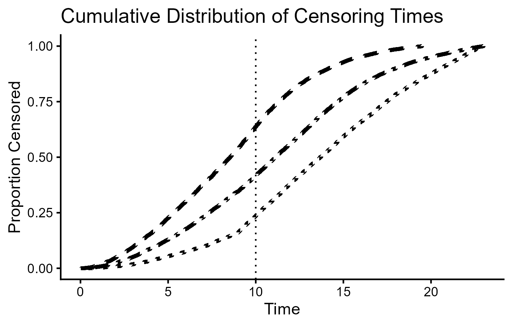{#fig-censoringCDF}

## Confidence Bands of RCS Smoother

@fig-SMADwithCI, @fig-MATEwithCI, @fig-MCWwithCI and @fig-meanpvaluewithCI show the RCS smoother confidence bands of the method with the generally lowest ($RF$) and highest ($GEE_{complex}$) variance.

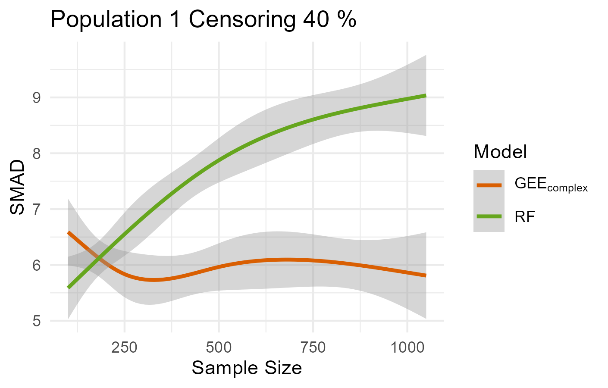{#fig-SMADwithCI}

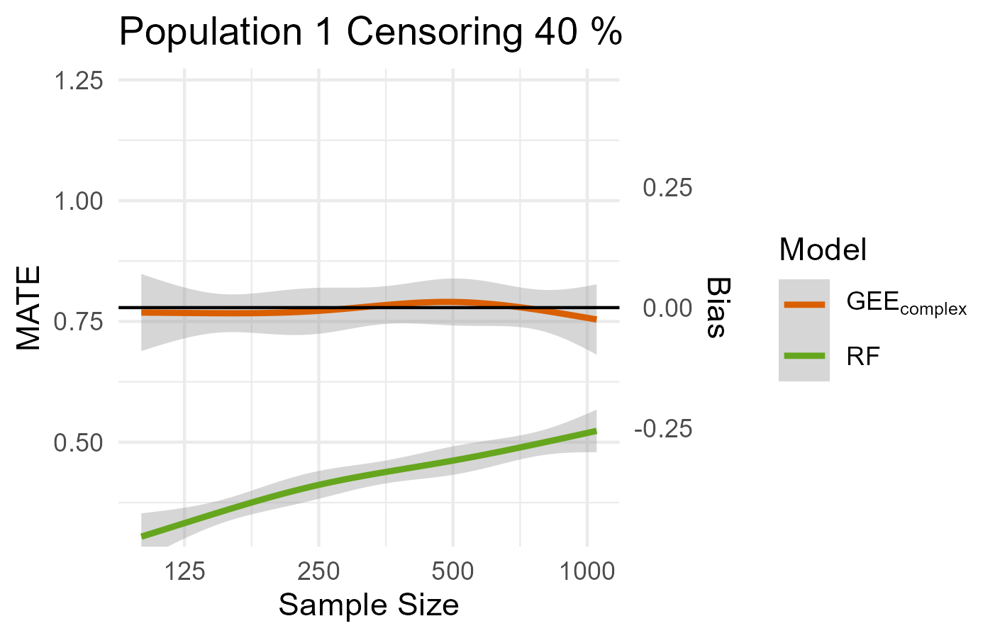{#fig-MATEwithCI}

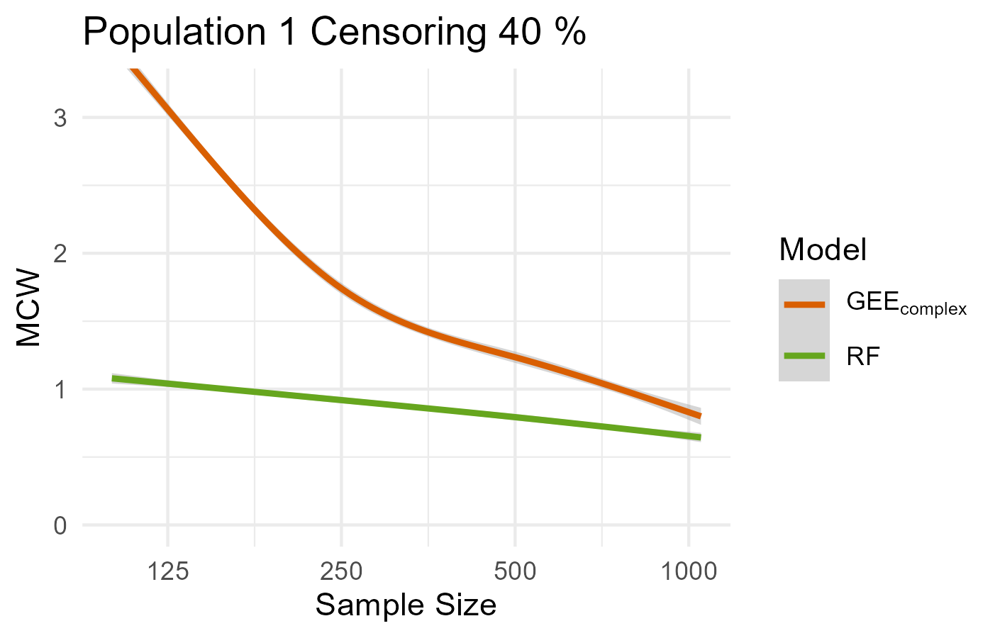{#fig-MCWwithCI}

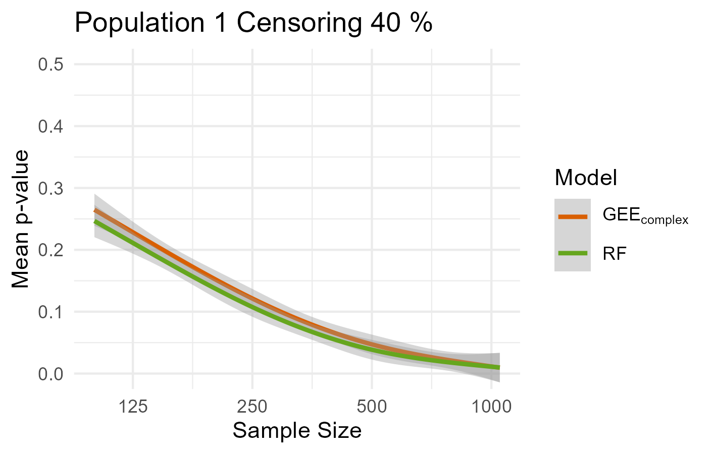{#fig-meanpvaluewithCI}


## Additional Results

Results for 20% and 60% censoring level are found here. **SMAD**: @fig-SMAD20, @fig-SMAD60. **MATE**: @fig-MATE20, @fig-MATE60. **MCW**: @fig-MCW20, @fig-MCW60. **Mean p-value**: @fig-meanpvalue20, @fig-meanpvalue60.  

### SMAD

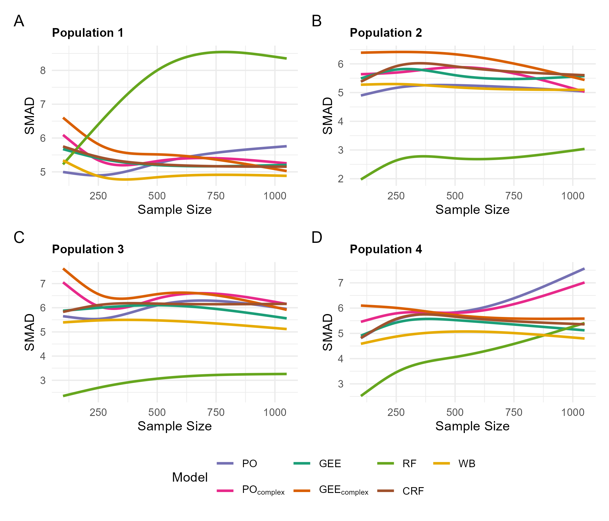{#fig-SMAD20}

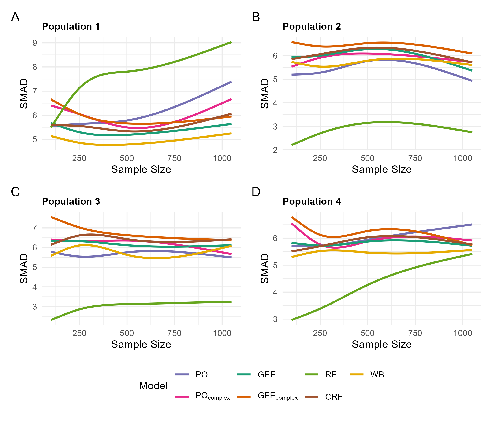{#fig-SMAD60}


### MATE

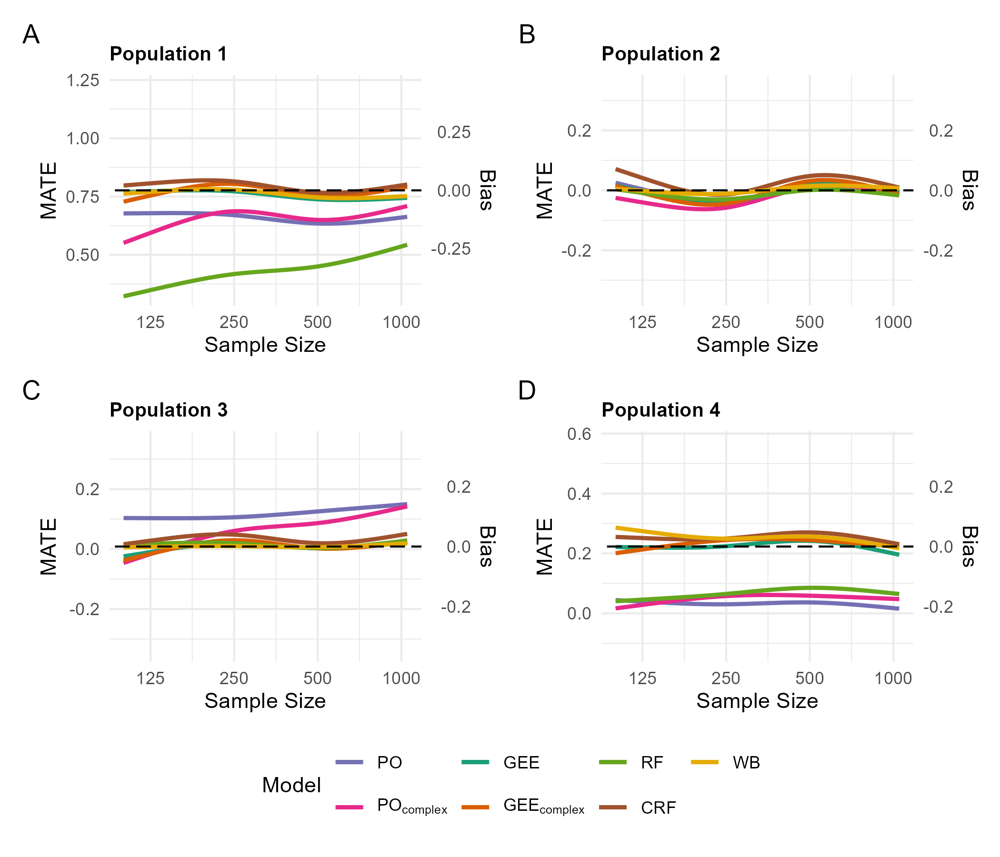{#fig-MATE20}

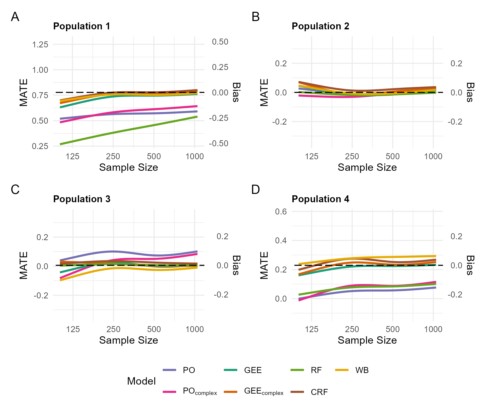{#fig-MATE60}

### MCW

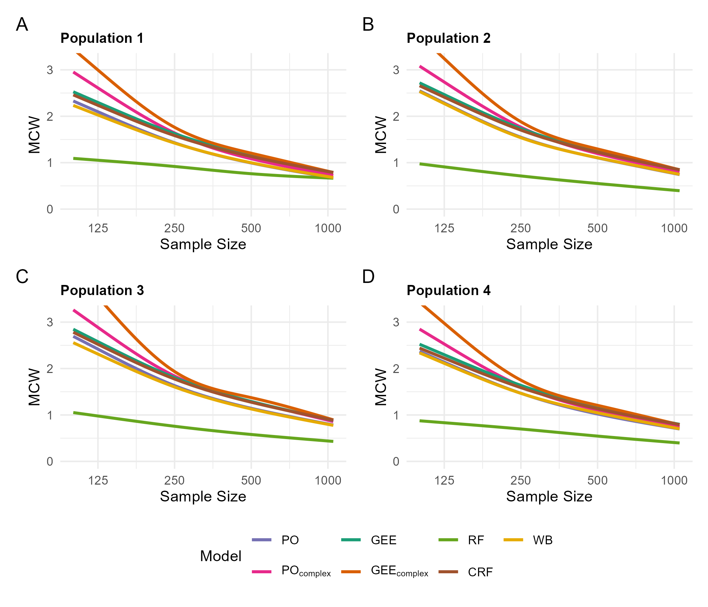{#fig-MCW20}

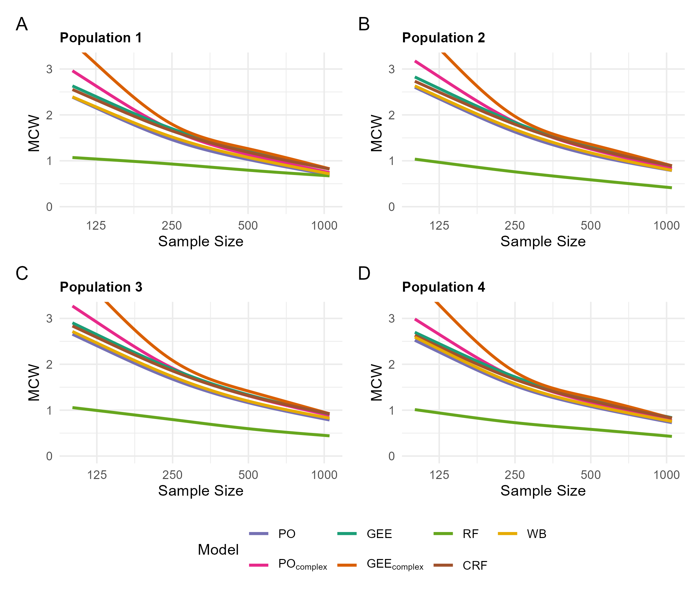{#fig-MCW60}


### Mean p-value

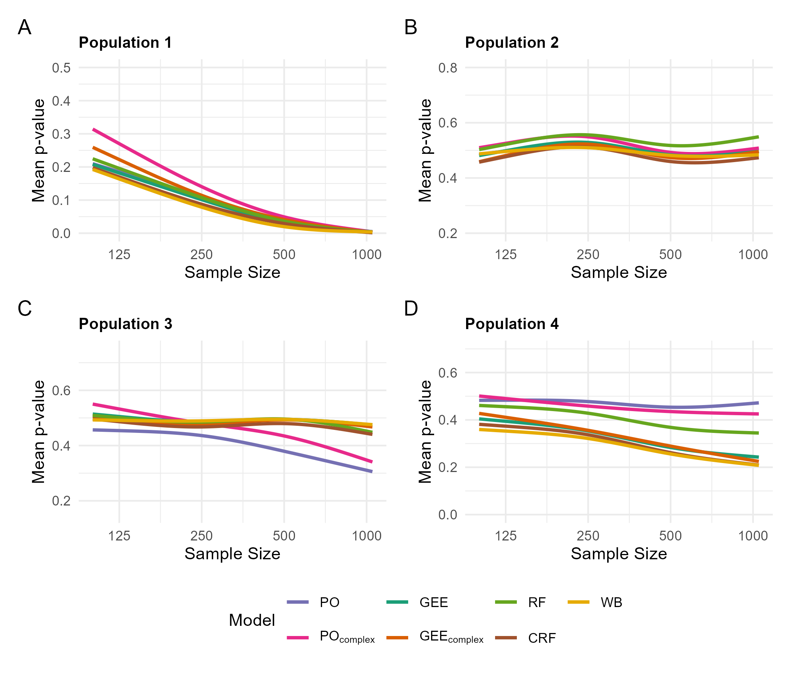{#fig-meanpvalue20}

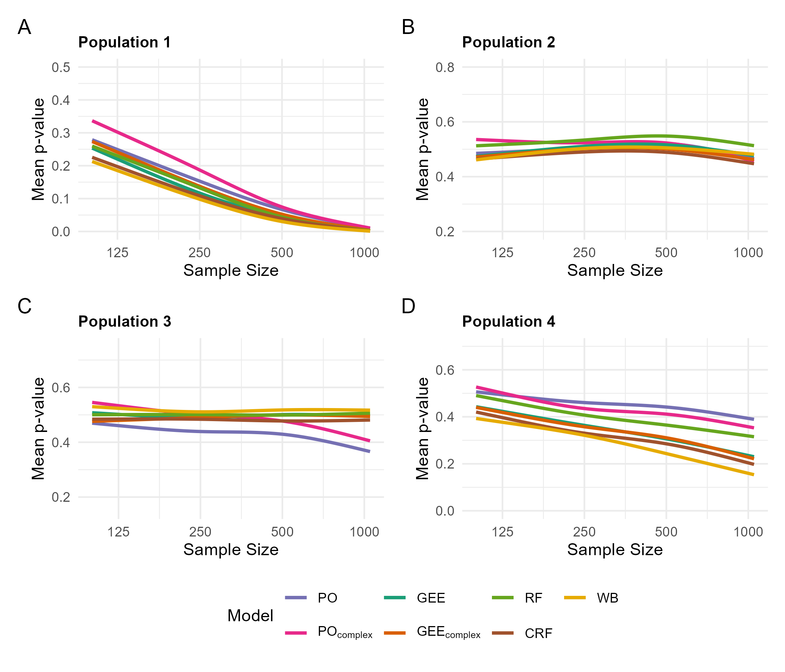{#fig-meanpvalue60}
